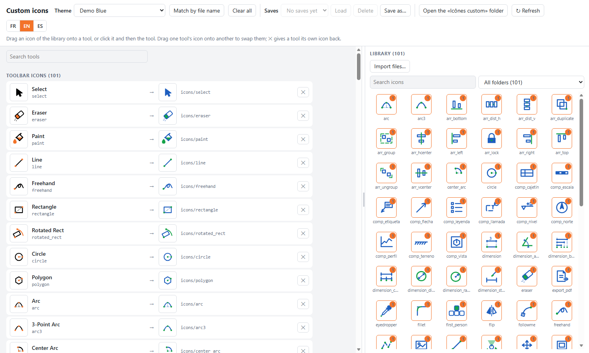
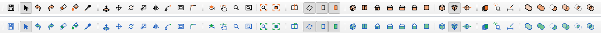

# Custom Icons for IngeTrazo

An [IngeTrazo](https://github.com/ingelibre/ingetrazo) extension that
replaces the toolbar icons and the 3D view's cursors with your own **SVG**
files, paired on a page in your browser.

IngeTrazo draws its icons in code, so there are no image files to swap.
This extension writes them out as SVG files for reference. You drop your
own SVG files in a folder, then pair them with IngeTrazo's icons by
dragging, on a page that shows both side by side.



### Video https://www.youtube.com/watch?v=jNxoq_PBpcA


### Example: the «Demo Blue» theme

IngeTrazo's toolbar with its own icons (top) and with the example theme
shipped here, `examples/themes/Demo Blue` (bottom):



Demo Blue is IngeTrazo's own icons recoloured (GPL, like IngeTrazo), with
its `mapping.json`: copy its folder into `Icônes custom` to try it, or use
it as a starting point for your own theme.

## Install

Version **1.1** — see [CHANGELOG.md](CHANGELOG.md).

1. Download [`custom_icons-1.1.zip`](https://raw.githubusercontent.com/APBureauEtude/ingetrazo-custom-icons/v1.1/dist/custom_icons-1.1.zip)
   and unzip it: it holds one folder, `custom_icons`.
2. In IngeTrazo: **Extensions ▸ Open plugins folder**.
3. Copy the `custom_icons` folder into it (the folder itself, with its
   three files).
4. Restart IngeTrazo.

The extension creates its folder at the first start:

- Windows: `%APPDATA%\ingetrazo\custom_icons\`
- Linux: `~/.local/share/ingetrazo/custom_icons/`

| Inside | What it is |
|---|---|
| `Icônes originales/` | Every IngeTrazo icon as `<key>.svg`, written again at each start. A reference and a template, never read back. |
| `Icônes custom/<theme>/` | One folder per icon theme: its SVG files, in any subfolders, its `mapping.json` (which file replaces which icon, written by the page), its `Sauvegardes/` (saved pairings) and its `Importées/` (icons brought in from another theme or from your computer). Share a theme by sharing its folder. |
| `settings.json` | The theme in use. Until you choose one, the first theme folder is used. |

## Use

1. Make a theme: a folder inside `Icônes custom`, with your SVG files in
   it, in subfolders if you like. **Open the «Icônes custom» folder** on
   the page (or **Extensions ▸ Custom icons ▸ Open icons folder**) takes
   you there.
2. **Extensions ▸ Custom icons ▸ Choose icons…** opens the page in your
   browser. Pick the theme at the top (or **None** for IngeTrazo's own
   icons). IngeTrazo's icons are listed on the left, each with the file
   that replaces it. The theme's library is on the right: all its files,
   from all its subfolders, with a search box and a folder filter. An
   icon stays in the library once used (a badge says how many tools it
   serves), so one icon may serve several tools.
3. Pair them:
   - drag an icon of the library onto a tool, or click it and then click
     the tool;
   - drag one tool's icon onto another to swap them;
   - drag a tool's icon back to the library, or press ✕, to give the
     tool its own icon back.
4. Added or changed files while the page is open? Press **Refresh**.
5. **Save as…** keeps the current choices under a name; pick one in
   **Saves** and press **Load** to get it back (or **Delete**).

### Icons from elsewhere

- **From another theme:** pick it in the list above the library. Use one
  of its icons on a tool and it is copied into the theme in use first, in
  `Importées/<that theme>/`, so the theme stays whole when shared.
  **Import the N icons shown** copies everything the filter shows at once
  (a whole subfolder, say).
- **From your computer:** **Import files…**, or drop SVG files from your
  file manager onto the library. They go into the theme's `Importées/`.

An icon imported twice is not copied twice; a different file of the same
name becomes «name (2)».

The page speaks French, English or Spanish: the **FR · EN · ES** buttons
at the top.

Each change is saved at once, and IngeTrazo shows it at once, with no
restart. The page also lists the 3D view's cursors. Drag the bar between
the two columns to widen or narrow the library (double-click it to
reset).

Until a theme's first change, it is paired by file name, with IngeTrazo's
own names, those of `Icônes originales/`: `line.svg` → the Line icon,
`cursors/line.svg` → the Line tool's cursor… So a theme made from copies of
the originals is paired on its own. **Match by file name** puts that
pairing back. [NAMES.md](NAMES.md) lists the names, and which file wins
when a name is found in several subfolders.

### Drawing your SVG

- Any square canvas works. The originals use `viewBox="0 0 48 48"` with a
  margin of 8.
- `currentColor` is painted in the interface's text colour, so the icon
  follows the light and dark themes. The originals use it for their lines.
  Any other colour (such as the orange accent `#f37329`) stays as it is.
- A cursor is drawn at 32 × 32. It clicks where its drawing points
  (a pencil's tip, an arrow's point…), found in the drawing itself; see
  [NAMES.md](NAMES.md).

### The page

The page is served by IngeTrazo itself, on your computer only
(`127.0.0.1`), at an address that holds a random key and changes at each
start. No other computer, and no website, can reach it. It works only
while IngeTrazo is open.

## Icons you may share

This repository contains no icons from any other program.
Only use, and only share, icon sets you have the right to.

## Compatibility

Tested with IngeTrazo 0.5.7. The plugin API is not stable yet (IngeTrazo
0.x). This extension also uses internal parts of IngeTrazo:
`views.icons.tool_icon`, `tool_cursor` and `_DRAW`, and the main window's
icon refresh. A future version may change them. If that happens,
IngeTrazo still starts: the menu shows the extension as a load error, or
the built-in icons stay in place.

## Tests

From this folder, with IngeTrazo's Python, IngeTrazo checked out beside
this repository (or set `INGETRAZO_DIR`):

```
..\ingetrazo\venv\Scripts\python -m pytest tests     # Windows
../ingetrazo/venv/bin/python -m pytest tests         # Linux
```

## Questions, ideas, bugs

Open an [issue](https://github.com/APBureauEtude/ingetrazo-custom-icons/issues).
Questions in French, English or Spanish are welcome.

---

### En français

Extension pour IngeTrazo qui remplace les icônes des barres d'outils et
les curseurs de la vue 3D par vos propres fichiers SVG, rangés en thèmes.
Copiez le dossier `custom_icons` dans le dossier des extensions
(**Extensions ▸ Open plugins folder**) et redémarrez. Chaque thème est un
dossier dans `%APPDATA%\ingetrazo\custom_icons\Icônes custom\`, avec ses
SVG dans des sous-dossiers si vous voulez. **Extensions ▸ Custom icons ▸
Choose icons…** ouvre une page dans le navigateur : choisissez le thème,
puis glissez une icône sur un outil (ou cliquez-la puis cliquez l'outil).
Chaque changement est enregistré et visible aussitôt dans IngeTrazo.

### En español

Extensión de IngeTrazo que reemplaza los iconos de las barras y los
cursores de la vista 3D por sus propios archivos SVG, ordenados en temas.
Copie la carpeta `custom_icons` en la carpeta de extensiones
(**Extensiones ▸ Abrir carpeta de complementos**) y reinicie. Cada tema es
una carpeta dentro de `%APPDATA%\ingetrazo\custom_icons\Icônes custom\`,
con sus SVG en subcarpetas si quiere. **Extensiones ▸ Iconos
personalizados ▸ Elegir los iconos…** abre una página en el navegador:
elija el tema y arrastre un icono sobre una herramienta (o haga clic en
él y luego en la herramienta). Cada cambio se guarda y se ve al instante
en IngeTrazo.

## License

GPL-3.0-or-later, like IngeTrazo. See [LICENSE](LICENSE).
